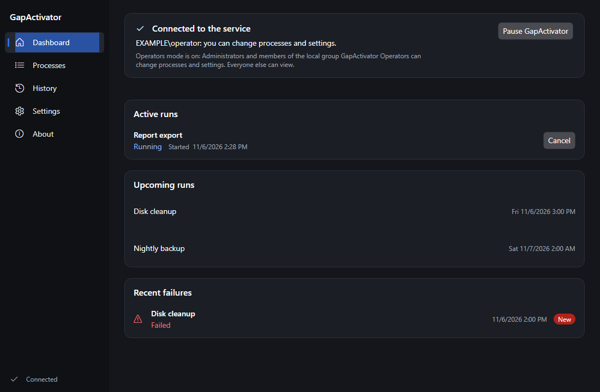
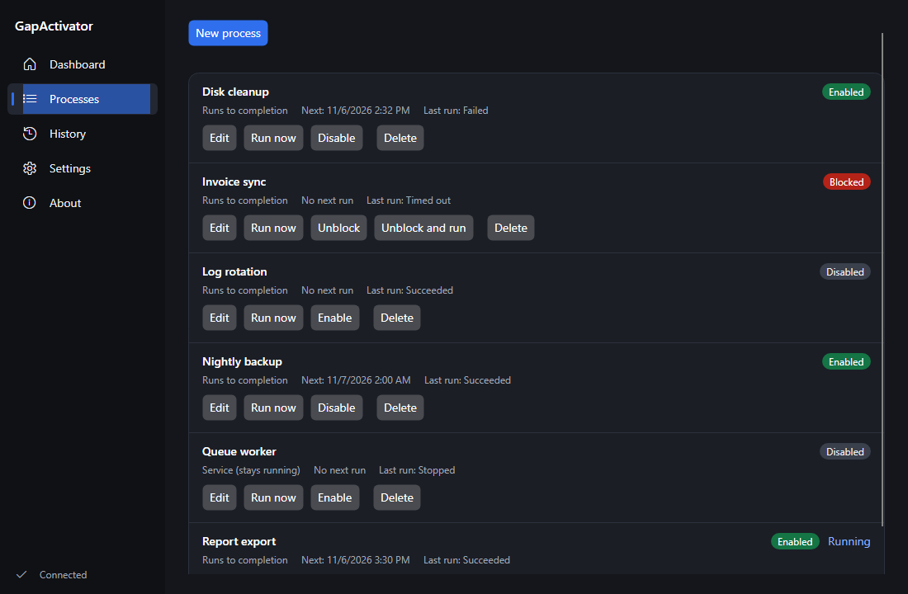
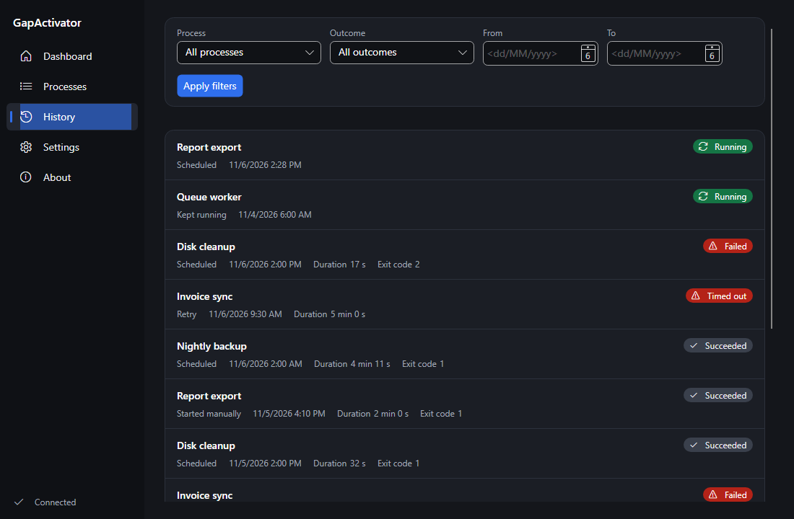
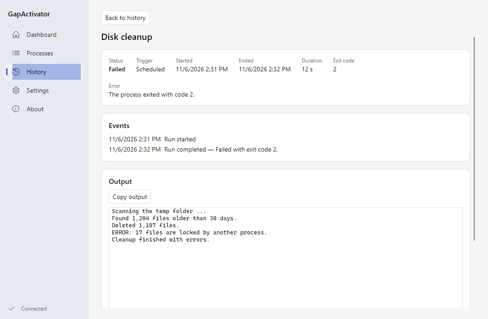
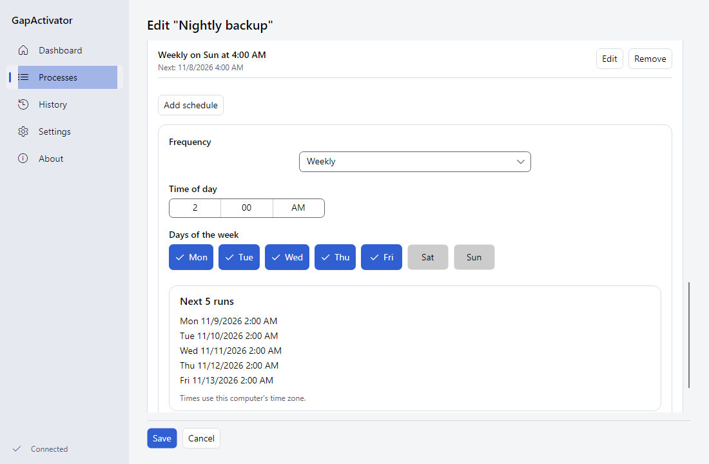
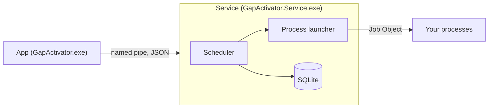

# GapActivator

[](https://github.com/Gustavo-Piccoli/GapActivator/actions/workflows/ci.yml)
[](https://github.com/Gustavo-Piccoli/GapActivator/actions/workflows/codeql.yml)
[](https://github.com/Gustavo-Piccoli/GapActivator/releases/latest)
[](LICENSE)

GapActivator is an open-source scheduled-process runner for Windows. A Windows service starts the programs you register, on the schedules you give them, watches them, records every run and tells you when one fails. A desktop app shows what is happening and lets you change it.



## Features

- **Two kinds of process.** A run-to-completion process starts on its schedules and ends with an outcome. A service-kind process must stay up: GapActivator relaunches it when it exits.
- **Schedules.** One-time dates and recurring rules (iCalendar RRULE, MINUTELY or coarser). The editor offers every N minutes or hours, daily, weekly, monthly and once, and an advanced raw rule with a preview of the next five occurrences.
- **Supervision.** Run now, cancel, enable, disable and unblock. Each process has an optional time limit and a cancellation grace period. A process that fails too many times in a row is blocked until you unblock it.
- **History.** Every run is recorded with its outcome, exit code, duration, events and captured output. A schedule that comes due while the previous run is still active is recorded as skipped.
- **Pause.** Pause the whole installation: no new run starts until you resume it.
- **Alerts.** Windows notifications through the app, and optional e-mail through your own SMTP server.
- **Safe by default.** The service runs under a virtual account with no password, the data folder is locked down, and only Administrators (and, in the default mode, the `GapActivator Operators` group) can change anything.
- **The app.** Dashboard, Processes, History, Settings and About; light and dark themes; English and Brazilian Portuguese; a tray icon colored by state.

| | |
|---|---|
|  |  |
|  |  |

## How it works

Two programs make up GapActivator:

- **The service** (`GapActivator.Service.exe`) is the only program that touches the database. It runs the scheduler, launches and supervises the child processes, writes the history and the logs, sends the alerts and listens on a named pipe.
- **The app** (`GapActivator.exe`) is a client of that pipe. It holds no data of its own, so it needs the service to be running, and it shows when it is not.



[docs/architecture.md](docs/architecture.md) describes the layers and the pipe protocol.

## Install

1. Download `GapActivator-Setup-<version>-x64.exe` (Intel and AMD) or `GapActivator-Setup-<version>-arm64.exe` (Windows on ARM) from [GitHub Releases](https://github.com/Gustavo-Piccoli/GapActivator/releases/latest). There is no portable build, because a Windows service cannot run loose.
2. Optional: verify the file against `SHA256SUMS.txt`, from the same release:

   ```powershell
   Get-FileHash .\GapActivator-Setup-<version>-x64.exe -Algorithm SHA256
   # compare with the matching line in SHA256SUMS.txt
   ```

3. Run the installer. It needs administrator rights, because it registers a Windows service.

The builds are not code-signed yet, so Windows SmartScreen may warn you. Choose "More info" and then "Run anyway".

**Choosing the account.** The installer asks which account the service runs under.

- **Virtual service account `NT SERVICE\GapActivator` (recommended).** No password and least privilege. Your processes can only reach what you grant that account access to. The installing user is added to the local group `GapActivator Operators`, whose members can change processes and settings.
- **A specific account.** Your processes behave as if you ran them by hand. The installer asks for the password and the account gets the "Log on as a service" right. Because whoever changes the process list then runs programs with that account's rights, only Administrators can change anything in this mode.

[docs/installing.md](docs/installing.md) covers the installer pages, the silent switches, what gets created, upgrades and uninstall.

## First steps

1. Start GapActivator from the Start Menu (if you chose that shortcut). The dashboard shows the service state; if the service is stopped, the app offers to start it.
2. In **Processes**, add a process: a name, the full path of an executable, optional arguments, working directory and environment variables (a variable can be marked secret).
3. Add one or more schedules in the schedule editor.
4. Use **Run now** to try it. Follow the run in **History**, where its output is captured.

The repository includes a sample child, `samples/GapActivator.SampleChild`, that is handy for a first test.

## Writing a process

Any executable works as it is. Exit code `0` is success and any other code is a failure. A process that wants to stop gracefully can wait on a named event that GapActivator signals, and can learn who started it from two environment variables. [docs/child-contract.md](docs/child-contract.md) has the full contract and a complete sample.

## Who can do what

| Who | Can |
|---|---|
| Any user with an interactive logon (console or Remote Desktop) | View state, runs, history and settings. Viewers do not see process arguments or environment variable values. |
| Administrators (elevated token) | Everything. |
| Members of `GapActivator Operators` | Everything, but only when the service runs under the virtual account. |

Captured run output is visible to every viewer, so a process should never print secrets. [docs/running-the-service.md](docs/running-the-service.md) has the details.

## Where things live

| What | Where |
|---|---|
| Database | `%ProgramData%\GapActivator\gapactivator.db` |
| Service logs | `%ProgramData%\GapActivator\logs\gapactivator-yyyyMMdd.log` |
| Output of each run | `%ProgramData%\GapActivator\logs\runs\<run id>.log` |
| App settings | `%LocalAppData%\GapActivator\app-settings.json` |
| App log | `%LocalAppData%\GapActivator\logs` |
| Severe service errors | Windows Event Log, `Application`, source `GapActivator` |

Retention of logs and of history is set in Settings. The only network call the app makes is an optional update check to the GitHub API; it sends nothing but the product version and never downloads anything. Settings has a switch for it.

## Uninstall

Use "Installed apps" in Windows Settings. The uninstaller stops and removes the service, the event source and the `GapActivator Operators` group. It keeps `%ProgramData%\GapActivator` (your database and logs) unless you choose to delete it when asked, or pass `/DELETEDATA` to a silent uninstall.

## Build from source

You need Windows and the [.NET SDK](https://dotnet.microsoft.com/download) 10.0.403 or newer (pinned in `global.json`).

```powershell
dotnet build
dotnet test
```

To run the service in a console without touching `%ProgramData%`, see [docs/running-the-service.md](docs/running-the-service.md). [CONTRIBUTING.md](CONTRIBUTING.md) covers the rest, and [docs/RELEASING.md](docs/RELEASING.md) the packaging scripts.

## Documentation

| Document | Contents |
|---|---|
| [docs/installing.md](docs/installing.md) | Installer, silent install, what it creates, upgrade, uninstall |
| [docs/architecture.md](docs/architecture.md) | Layers, CQRS, the process launcher, the pipe protocol |
| [docs/child-contract.md](docs/child-contract.md) | What a child process can rely on |
| [docs/running-the-service.md](docs/running-the-service.md) | Console mode, exit codes, pipe and authorization |
| [docs/behavior-inventory.md](docs/behavior-inventory.md) | The behavior rules and the tests that cover them |
| [docs/adr/](docs/adr/0001-clean-architecture-and-cqrs-without-a-mediator.md) | Architecture decision records |
| [docs/future-work.md](docs/future-work.md) | Known limits and what comes next |
| [docs/RELEASING.md](docs/RELEASING.md) | How a release happens |
| [SECURITY.md](SECURITY.md), [CODE_OF_CONDUCT.md](CODE_OF_CONDUCT.md) | Reporting and conduct |

GapActivator shares its engineering conventions with its sibling project [GapMouse](https://github.com/Gustavo-Piccoli/GapMouse), a small utility that keeps a Windows PC awake.

## License

[MIT](LICENSE)
