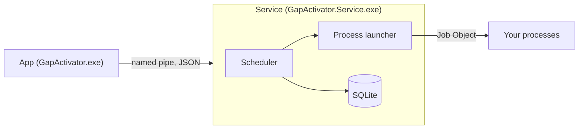
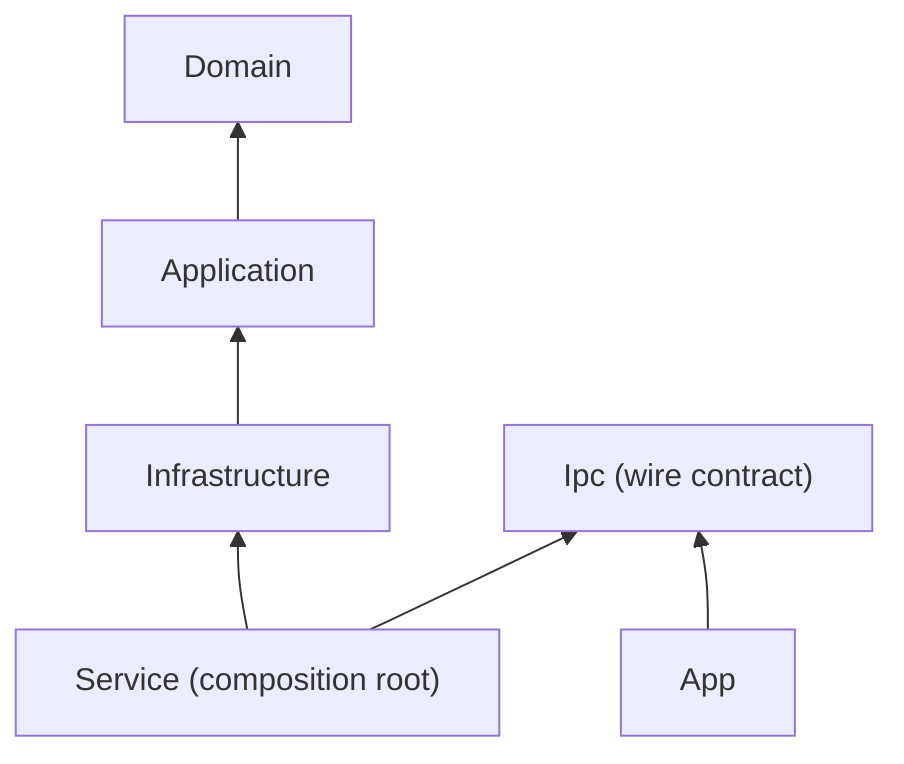

# Architecture

GapActivator is two programs. The **service** owns all data and behavior. The **app** is a client of the service over a named pipe. Both are written in C# on .NET 10 and share one repository.

## Runtime view

## Layers

| Project | Role |
|---|---|
| `GapActivator.Domain` | Aggregates (process, run, settings), value objects (schedules, recurrence rules, limits) and domain events. No packages, no I/O, and it never reads a clock. |
| `GapActivator.Application` | Commands, queries and their handlers, the ports (launcher, history, e-mail, secrets, service control) and the scheduler cycle. It depends only on the domain and a few Microsoft abstractions. |
| `GapActivator.Infrastructure` | Adapters for the ports: SQLite through EF Core, the Windows process launcher, DPAPI, MailKit, the Ical.Net occurrence calculator and file and Event Log logging. |
| `GapActivator.Service` | The Windows service host, the pipe server and its authorization, and the `setup` verb the installer calls. |
| `GapActivator.Ipc` | The wire contract: message and view types, the codec and a pipe client. It references no other GapActivator project and no package. |
| `GapActivator.App` | The Avalonia desktop app. It references only `Ipc`, never the domain, the application or the infrastructure, and it is published with Native AOT. |

The arrows point at the dependency. The service is the only place where the layers meet.

## Bounded contexts

The contexts are modules inside the same projects, not separate services.

| Context | Responsibility |
|---|---|
| Process Catalog | What to run, how and when: process registrations. |
| Scheduling | Schedules and the calculation of the next occurrence. |
| Execution | Runs: launching, supervising, cancelling, outcomes, failure counting and blocking. |
| History and Logging | Run history and run events in the database, plus the log files. |
| Notifications | Reactions to domain events: Windows notifications through the app and optional e-mail. |
| Settings | Installation-wide settings. |

## CQRS without a mediator

A change is a command and a read is a query. Each has exactly one handler, resolved from the dependency-injection container and invoked through two small interfaces, `ICommandHandler<TCommand, TResult>` and `IQueryHandler<TQuery, TResult>`, by a thin dispatcher that lives in the Application project. There is no mediator library. A rejected command throws a `CommandRejectedException` carrying a stable code such as `name-taken` or `process-blocked`, which the pipe returns to the client as an error code. Domain events are collected while a command runs and published after the commit. An architecture test fails the test run, and so CI, when a message has no handler or more than one. [ADR 0001](adr/0001-clean-architecture-and-cqrs-without-a-mediator.md) gives the reasons.

## The scheduler cycle

The service runs a loop at a configurable interval. Each cycle evaluates every process: it starts the ones that are due, supervises the ones that are running and relaunches service-kind processes that exited. The work for one process never blocks another, so a long run does not hold up the rest. When the service starts, a reconciliation step runs first. It re-adopts children that outlived a crash and closes the runs whose process is gone. The pipe opens only after that step.

## The process launcher

The launcher creates each child suspended with `CreateProcessW`, places it in a Job Object and then resumes it. The child's standard input is `NUL`, and its standard output and standard error go to one file per run. To stop a child, the service sets a named event the child can wait on, waits for the grace period and then kills the whole process tree through the job. `System.Diagnostics.Process` is used only as a fallback to kill. [ADR 0005](adr/0005-job-objects-and-the-child-contract.md) and [docs/child-contract.md](child-contract.md) have the details.

## The pipe protocol

The app and the service talk over the named pipe `GapActivator`, in byte mode.

- **Framing.** Each frame is a 4-byte little-endian length followed by UTF-8 JSON, at most 16 MiB.
- **Messages.** A request is `{id, type, payload}` with `id` of at least 1. A response is `{id, ok, payload}` or `{id, ok: false, error: {code, message, retryable}}`. A push from the service is `{event, payload}`. Names are camelCase and enums are exact, case-sensitive names. `ProtocolVersion` is 1, checked in a Hello exchange.
- **Errors.** The codes are the application's rejection codes, plus `conflict`, `invalid`, `unknown-message`, `internal`, `service-stopping`, `protocol-mismatch` and `busy`. The client alone raises `disconnected` and `server-not-verified`. `conflict`, `busy`, `service-stopping` and `disconnected` are retryable.
- **Limits.** At most eight requests run at once per connection, and further requests wait for a free slot. At most sixteen connections; a seventeenth gets `busy`. A Hello timeout of 10 seconds and a write timeout of 5 seconds, after which the connection is dropped. `StateChanged` is pushed at most once per 250 ms per connection, and a push queue of 256 per connection drops the oldest.
- **Pushes before Hello** are dropped by design, so a client queries the state right after it connects.
- **Authorization.** The pipe ACL admits interactive users to view and the service re-checks every command on the server. See [running-the-service.md](running-the-service.md).

[ADR 0003](adr/0003-the-app-is-a-pure-client-over-a-named-pipe.md) explains why the app is a client.

## How the architecture tests enforce the rules

`tests/GapActivator.Architecture.Tests` turns the rules above into tests that run in CI, so a violation fails the run.

- The domain depends on no other layer and on no framework or I/O, has no package or project references and never reads a clock.
- The application depends only on the domain and on an allowed list of abstractions, and never reads the system clock.
- The infrastructure does not depend on the service or the app, and its packages are the justified ones.
- `Microsoft.Extensions.Hosting.WindowsServices` is referenced only by the service, and service code never creates a synchronous dependency-injection scope.
- Every command and query has exactly one registered handler.
- `Ipc` depends on no GapActivator layer, has no references and is AOT-compatible and Windows-only.
- The app references only `Ipc`, depends on no server layer, uses only the justified packages, is an AOT Windows executable and keeps its view models away from the pipe client.
- Every wire type mirrors its application type property for property, the wire enums have the same members as the application and domain enums, and the error codes contain every rejection code with the same string.
- Query views expose no domain type other than identifiers and enums.
